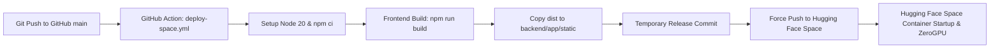

# SkillBridge AI - Deployment Guide

This guide details the automated deployment workflow that synchronizes the SkillBridge AI repository on GitHub with the production Hugging Face Space ([`anish-114/skillbridge-ai`](https://huggingface.co/spaces/anish-114/skillbridge-ai)).

---

## Architecture Overview

- **Source of Truth**: The GitHub `main` branch contains clean source code (compiled frontend assets are excluded via `.gitignore`).
- **Build Server**: GitHub Actions executes the Vite + TypeScript frontend build in a clean container.
- **Production Target**: Built static assets are committed to a temporary release commit on the GitHub Actions runner and pushed directly to `https://huggingface.co/spaces/anish-114/skillbridge-ai`.

---

## 1. Setting Up `HF_TOKEN` Secret on GitHub

To authorize GitHub Actions to push deployments to your Hugging Face Space, add your Hugging Face access token with **write** permissions:

### Step 1: Generate a Write Token on Hugging Face
1. Log in to [Hugging Face](https://huggingface.co).
2. Go to **Settings > Access Tokens**: [https://huggingface.co/settings/tokens](https://huggingface.co/settings/tokens).
3. Click **Create new token** (or select **User Access Token**).
4. Provide a token name (e.g., `skillbridge-github-deploy`).
5. Select **Role: Write** (or ensure repository write permissions for Spaces are enabled).
6. Copy the generated token (`hf_...`).

### Step 2: Add the Secret to Your GitHub Repository
1. Open your GitHub repository in your web browser.
2. Click the **Settings** tab (gear icon at the top).
3. In the left navigation menu, expand **Secrets and variables** and click **Actions**.
4. In the **Repository secrets** section, click the **New repository secret** button.
5. Fill in the secret details:
   - **Name**: `HF_TOKEN`
   - **Secret**: Paste your Hugging Face token copied in Step 1.
6. Click **Add secret**.

> [!NOTE]
> GitHub Actions automatically masks secret values in all workflow execution logs (`***`), ensuring your access token is never exposed.

---

## 2. Automated Deployment Workflow

The workflow file is located at [`.github/workflows/deploy-space.yml`](.github/workflows/deploy-space.yml).

### Triggers:
- **Automatic**: Triggered on every `git push` to the `main` branch.
- **Manual**: Can be triggered on-demand via the **Run workflow** button under GitHub Actions (`workflow_dispatch`).

### Workflow Steps:
1. **Checkout Repository**: Checks out the complete git commit history.
2. **Setup Node.js**: Configures Node.js 20 with `npm` dependency caching based on `frontend/package-lock.json`.
3. **Install Dependencies**: Executes `npm ci` inside `frontend/`.
4. **Build Frontend**: Executes `npm run build` (`tsc && vite build`), generating production assets in `frontend/dist/`.
5. **Copy Assets**: Synchronizes `frontend/dist/*` into `backend/app/static/`.
6. **Temporary Release Commit & Push**:
   - Stages `backend/app/static/` using `git add -f`.
   - Creates a temporary commit: `Deploy production build to Hugging Face Space [skip ci]`.
   - Force-pushes directly to Hugging Face Spaces `HEAD:main`.
   - **Result**: GitHub `main` remains clean without binary/compiled files, while Hugging Face Space receives the full running application with static files ready to be served.

---

## 3. Monitoring Deployments & Viewing Logs

If a deployment fails, diagnostics can be found in two places:

### A. GitHub Actions Logs (Build & Push Phase)
1. In your GitHub repository, click on the **Actions** tab.
2. Select the **Deploy to Hugging Face Space** workflow from the left sidebar.
3. Click on the latest run (e.g. `feat: ...` or `fix: ...`).
4. Click on the **Build Frontend & Deploy to Space** job to inspect live output.
5. Expand individual steps to view detailed error messages:
   - **Install Frontend Dependencies**: Check for missing npm packages or peer dependency conflicts.
   - **Build Frontend Application**: Check for TypeScript compilation errors (`tsc`) or Vite bundler failures.
   - **Deploy to Hugging Face Space**: Check for authentication errors (e.g. Invalid `HF_TOKEN` or insufficient permissions).

### B. Hugging Face Space Logs (Runtime & Server Phase)
1. Navigate to your Hugging Face Space: [https://huggingface.co/spaces/anish-114/skillbridge-ai](https://huggingface.co/spaces/anish-114/skillbridge-ai).
2. Click the **Logs** tab (or **App > Logs**).
3. Here you will see:
   - Container startup output.
   - ZeroGPU initialization (`@spaces.GPU` engine status).
   - FastAPI server startup logs (`uvicorn.run`).
   - Database migrations and table initialization logs (`init_db`).
   - Real-time API requests and error stack traces.

---

## 4. Scheduled Events Synchronization

External event data synchronization runs via a separate workflow: [`.github/workflows/events-sync.yml`](.github/workflows/events-sync.yml).

- **Schedule**: Executes automatically every 6 hours (`0 */6 * * *`).
- **Manual Trigger**: Can be run manually with an optional custom `space_url` input.
- **Authentication**: Uses `secrets.EVENTS_SYNC_TOKEN` to call `/api/events/sync`.
